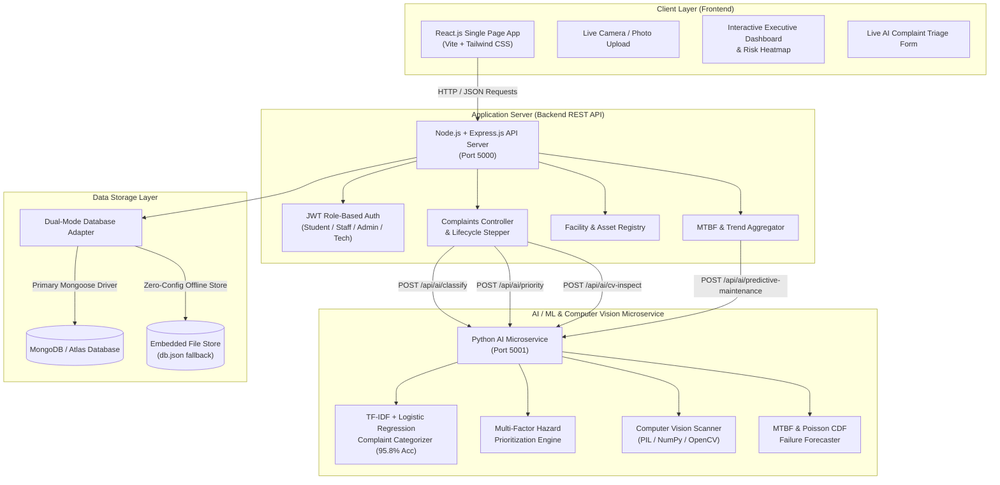
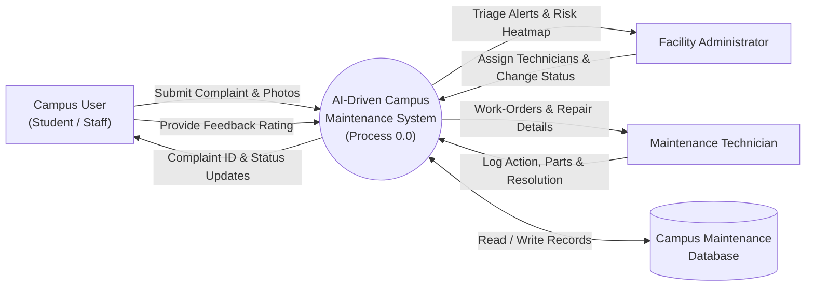
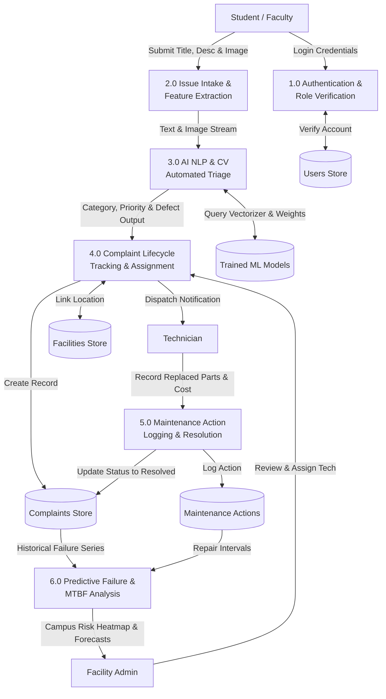
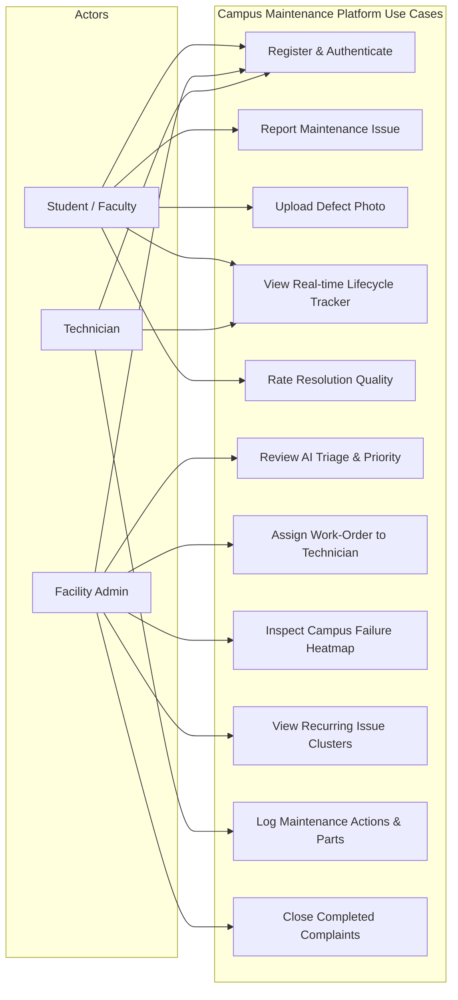

# System Architecture & Data Flow Diagrams (DFD)
**Project Title:** AI-Driven Predictive Campus Maintenance & Facility Management System  
**Institution:** Jagan Institute of Management Studies (JIMS), Sector-5, Rohini, Delhi  
**Affiliated to:** Guru Gobind Singh Indraprastha University (GGSIPU)  
**Programme:** Master of Computer Applications (MCA), Semester 3  
**Authors:** Varun Malik, Shankar Sumar, Aditya  

---

## 1. System Architecture Diagram

---

## 2. Level-0 Data Flow Diagram (DFD Context Diagram)

---

## 3. Level-1 Data Flow Diagram (Detailed Processes)

---

## 4. Use Case Diagram

